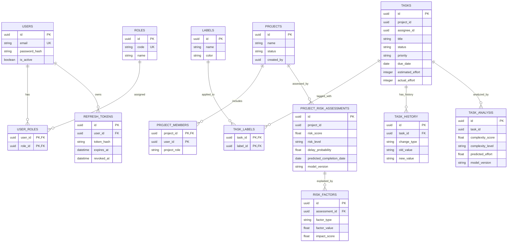

# Программное средство управления проектной деятельностью ИТ-компании

## 1. О проекте

Проект представляет собой веб-приложение для управления проектной деятельностью ИТ-компании. Система объединяет инструменты управления проектами и задачами, взаимодействия участников, уведомлений, аналитической отчётности, интеллектуального анализа характеристик задач и прогнозирования рисков выполнения проектов.

Разрабатываемое программное средство предназначено для централизованного управления проектами, распределения задач между сотрудниками, контроля сроков и хода выполнения работ, а также поддержки принятия управленческих решений на основе анализа накопленных данных.

Архитектура приложения — микросервисная. Каждый сервис отвечает за отдельную область предметной деятельности и владеет собственными данными. Для синхронного взаимодействия используется REST API, для асинхронного обмена событиями — Apache Kafka.

Основные возможности системы:

1. Управление проектами: создание, редактирование, архивирование, восстановление, завершение и управление участниками.
2. Управление задачами: создание, назначение исполнителей, установка приоритетов, сроков, статусов и меток.
3. Отслеживание истории изменения статусов, сроков и исполнителей.
4. Обсуждение задач посредством комментариев.
5. Отправка уведомлений о назначении задачи, изменении её статуса, появлении нового комментария и приближении срока выполнения.
6. Формирование статистических отчётов о выполнении проектов и задач.
7. Анализ сложности задач и прогнозирование предполагаемых трудозатрат.
8. Прогнозирование рисков выполнения проекта в целом.
9. Определение факторов, влияющих на вероятность нарушения сроков проекта.
10. Формирование рекомендаций менеджеру проекта на основании результатов анализа.
11. Поиск и фильтрация проектов и задач.

---

## 2. Технологический стек

| Область | Технология | Назначение |
|---|---|---|
| Backend | Java 21 | Основной язык разработки |
| Backend Framework | Spring Boot 3.5.x | Разработка микросервисов |
| Сборка | Maven | Управление зависимостями и сборка |
| Синхронное взаимодействие | REST API, Spring Web | Обработка пользовательских запросов и взаимодействие сервисов |
| API Gateway | Spring Cloud Gateway | Единая точка входа и маршрутизация запросов |
| Безопасность | Spring Security, JWT | Аутентификация и авторизация |
| Основные базы данных | PostgreSQL | Хранение операционных данных |
| ORM | Spring Data JPA, Hibernate | Работа с реляционными базами данных |
| Миграции БД | Flyway | Управление версиями схем баз данных |
| Асинхронное взаимодействие | Apache Kafka, Spring for Apache Kafka | Обмен событиями между сервисами |
| Аналитическое хранилище | ClickHouse | Хранение аналитических данных и агрегатов |
| Интеллектуальный анализ | Smile 4.4.2 | Анализ характеристик задач и прогнозирование проектных рисков |
| Frontend | React, TypeScript, Vite | Разработка клиентского веб-приложения |
| UI-библиотека | Material UI | Пользовательский интерфейс |
| Визуализация данных | Recharts | Построение графиков и диаграмм |
| Документирование API | Springdoc OpenAPI, Swagger UI | Документирование REST API |
| Тестирование | JUnit 5, Mockito, Testcontainers | Модульное и интеграционное тестирование |
| Контейнеризация | Docker, Docker Compose | Развёртывание приложения и инфраструктуры |
| Контроль версий | Git, GitHub | Управление исходным кодом |

### 2.1. Smile

Для реализации интеллектуального анализа используется библиотека Smile (Statistical Machine Intelligence and Learning Engine).

Smile применяется в `intelligence-service` для:

- анализа характеристик задач;
- оценки сложности задач;
- прогнозирования предполагаемых трудозатрат;
- обработки накопленных данных о выполнении задач и проектов;
- построения моделей прогнозирования рисков выполнения проектов;
- оценки вероятности нарушения сроков.

Поскольку основной версией Java в проекте является Java 21, используется ветка Smile 4.4.x, совместимая с данной версией Java.

Зависимость Maven:

```xml
<dependency>
    <groupId>com.github.haifengl</groupId>
    <artifactId>smile-core</artifactId>
    <version>4.4.2</version>
</dependency>
```

Официальная документация: https://haifengl.github.io/

### 2.2. PostgreSQL и ClickHouse

PostgreSQL используется для хранения основных операционных данных системы. Каждому микросервису выделяется собственная база данных, что обеспечивает независимость хранения и обработки информации.

ClickHouse применяется в `reporting-service` для хранения аналитических событий, формирования агрегатов и построения статистических отчётов.

Таким образом, PostgreSQL является основным хранилищем данных предметной области, а ClickHouse используется для аналитической обработки информации.

### 2.3. Принципы взаимодействия компонентов

В системе применяются следующие принципы:

- REST используется для синхронного взаимодействия с клиентским приложением и получения данных от других сервисов.
- Apache Kafka используется для асинхронной передачи событий между микросервисами.
- Каждый сервис имеет собственную базу данных и самостоятельно управляет её содержимым.
- Прямое обращение одного сервиса к таблицам другого сервиса запрещено.
- Для межсервисных ссылок используются идентификаторы соответствующих объектов.
- Обработчики Kafka должны учитывать возможность повторной доставки сообщений.
- Результаты интеллектуального анализа используются для поддержки принятия решений и не изменяют автоматически параметры проектов или задач.

---

## 3. Роли пользователей и их полномочия

В системе предусмотрены три основные роли:

- `ADMIN` — администратор системы;
- `PROJECT_MANAGER` — менеджер проекта;
- `EMPLOYEE` — сотрудник.

Системная роль определяет общие полномочия пользователя. Дополнительные ограничения доступа определяются его участием в конкретном проекте и назначением исполнителем задачи.

### 3.1. ADMIN

Администратор обладает глобальными полномочиями.

Основные возможности:

- просмотр всех пользователей и проектов;
- изменение системных ролей пользователей;
- выполнение операций менеджера проекта в любом проекте;
- просмотр всех задач и комментариев;
- просмотр аналитических отчётов;
- просмотр результатов интеллектуального анализа;
- запуск анализа задач и оценки рисков проектов;
- архивирование и восстановление проектов;
- завершение проектов с незавершёнными задачами после явного подтверждения.

Администратор не удаляет пользователей физически, чтобы сохранить целостность истории операций и связанных данных. При необходимости пользователь может быть деактивирован.

### 3.2. PROJECT_MANAGER

Менеджер управляет проектами, в которых он назначен менеджером.

Основные возможности:

- создание проектов;
- редактирование параметров собственных проектов;
- архивирование и восстановление проектов;
- добавление и исключение участников;
- создание, редактирование и удаление задач;
- назначение исполнителей;
- изменение сроков и приоритетов задач;
- изменение статусов любых задач собственного проекта;
- просмотр комментариев;
- просмотр аналитических отчётов;
- просмотр результатов интеллектуального анализа;
- запуск анализа сложности задач;
- запуск оценки риска проекта;
- просмотр рекомендаций по снижению риска проекта.

При исключении сотрудника из проекта менеджер должен предварительно переназначить его незавершённые задачи.

Менеджер не может изменять системные роли пользователей.

### 3.3. EMPLOYEE

Сотрудник участвует в одном или нескольких проектах.

Основные возможности:

- просмотр доступных ему проектов;
- просмотр задач, к которым у него есть доступ;
- просмотр назначенных ему задач;
- изменение статуса только собственных назначенных задач;
- просмотр комментариев к доступным задачам;
- добавление комментариев;
- просмотр результатов анализа сложности доступных ему задач.

Сотрудник не может:

- создавать проекты;
- управлять участниками проектов;
- создавать и удалять задачи;
- изменять исполнителя задачи;
- изменять срок выполнения задачи;
- изменять системные роли;
- изменять статус чужих задач;
- запускать административные операции интеллектуального анализа;
- просматривать закрытые сведения о проектах, к которым у него нет доступа.

### 3.4. Особенности разграничения доступа

Один пользователь может выступать менеджером в одном проекте и сотрудником в другом.

Администратор обладает глобальными полномочиями. Для менеджеров и сотрудников права определяются отдельно для каждого проекта.

Проверки доступа выполняются непосредственно в микросервисах, которые владеют соответствующими данными. API Gateway не является единственным уровнем защиты.

При обращении к защищённым ресурсам применяются следующие правила:

- `401 Unauthorized` — пользователь не прошёл аутентификацию или предоставил недействительный токен;
- `403 Forbidden` — пользователь аутентифицирован, но не обладает необходимыми полномочиями.

### 3.5. Матрица полномочий

| Операция | ADMIN | PROJECT_MANAGER | EMPLOYEE |
|---|---|---|---|
| Просмотр пользователей | Все | В доступных проектах | В разрешённом объёме |
| Изменение системных ролей | Да | Нет | Нет |
| Просмотр проектов | Все | Управляемые проекты | Доступные проекты |
| Создание проекта | Да | Да | Нет |
| Редактирование проекта | Любой | Свои проекты | Нет |
| Архивирование проекта | Любой | Свои проекты | Нет |
| Восстановление проекта | Любой | Свои проекты | Нет |
| Управление участниками | Любой проект | Свои проекты | Нет |
| Создание задач | Да | Свои проекты | Нет |
| Редактирование задач | Да | Свои проекты | Нет |
| Изменение исполнителя | Да | Свои проекты | Нет |
| Изменение срока | Да | Свои проекты | Нет |
| Изменение статуса | Любые задачи | Свои проекты | Назначенные задачи |
| Удаление задач | Да | Свои проекты | Нет |
| Просмотр комментариев | Все | Свои проекты | При наличии доступа |
| Добавление комментариев | Да | Свои проекты | При наличии доступа |
| Просмотр отчётов | Все | Свои проекты | Ограниченно |
| Просмотр анализа задач | Все | Свои проекты | Доступные задачи |
| Просмотр риска проекта | Все | Свои проекты | По умолчанию нет |
| Запуск анализа | Да | Свои проекты | Нет |
| Завершение проекта с незавершёнными задачами | После подтверждения | Нет | Нет |

---

## 4. Правила жизненного цикла проектов и задач

### 4.1. Жизненный цикл проекта

Проект может находиться в одном из трёх состояний:

- `ACTIVE` — активный проект;
- `ARCHIVED` — архивный проект;
- `COMPLETED` — завершённый проект.

#### ACTIVE

Активный проект находится в рабочем состоянии. Менеджер может создавать и редактировать задачи, изменять сроки, назначать исполнителей и управлять участниками.

#### ARCHIVED

Архивный проект доступен только для просмотра.

Для архивного проекта запрещены:

- создание новых задач;
- редактирование существующих задач;
- изменение состава участников;
- изменение сроков и исполнителей.

Восстановить архивный проект может администратор или менеджер данного проекта.

#### COMPLETED

Завершённый проект находится в окончательном состоянии.

Если все задачи проекта завершены, менеджер может перевести проект в состояние `COMPLETED`.

Если в проекте остались незавершённые задачи, завершить его может только администратор после явного подтверждения операции.

При завершении проекта незавершённые задачи не удаляются. Они сохраняются вместе с историей изменений.

### 4.2. Жизненный цикл задачи

Задача может иметь один из следующих статусов:

- `TODO` — ожидает выполнения;
- `IN_PROGRESS` — находится в процессе выполнения;
- `DONE` — завершена.

Для определения важности задач используются приоритеты:

- `LOW` — низкий;
- `MEDIUM` — средний;
- `HIGH` — высокий.

Назначенный сотрудник может изменять статус собственной задачи. Менеджер проекта может изменять статус любой задачи своего проекта.

Изменение исполнителя и срока выполнения доступно только менеджеру проекта или администратору.

В системе сохраняется история следующих изменений:

- статуса задачи;
- назначенного исполнителя;
- срока выполнения.

При исключении сотрудника из проекта его незавершённые задачи должны быть переназначены другому участнику.

### 4.3. Интеллектуальный анализ задач и проектов

Интеллектуальный модуль выполняет два взаимосвязанных, но самостоятельных вида анализа.

**Анализ характеристик отдельной задачи**

Для каждой задачи могут определяться:

- числовая оценка сложности;
- категория сложности: `LOW`, `MEDIUM`, `HIGH`;
- предполагаемые трудозатраты;
- дополнительные характеристики, использованные при анализе.

Оценка сложности и прогноз трудозатрат помогают менеджеру лучше планировать работу и распределять задачи между сотрудниками.

Риск отдельной задаче не присваивается.

**Прогнозирование риска проекта**

Оценка риска выполняется для проекта в целом. При расчёте учитываются совокупные характеристики проекта, в том числе:

- количество завершённых и незавершённых задач;
- распределение оставшихся задач по приоритетам;
- средняя сложность незавершённых задач;
- прогнозируемые трудозатраты;
- доля просроченных задач;
- скорость выполнения задач;
- загрузка сотрудников;
- частота изменения сроков;
- количество переназначений;
- объём оставшейся работы относительно времени до планового завершения.

Результатом оценки являются:

- числовой балл риска проекта;
- уровень риска: `LOW`, `MEDIUM`, `HIGH`;
- вероятность нарушения сроков;
- предполагаемая дата завершения;
- факторы, повлиявшие на оценку;
- рекомендации менеджеру проекта.

Если накопленных данных недостаточно для надёжного прогноза, система должна обозначить ограниченную достоверность результата или использовать доступный базовый алгоритм.

Результаты интеллектуального анализа носят рекомендательный характер. Они не приводят к автоматическому изменению сроков, исполнителей, статусов задач или состояния проекта.

---

## 5. Архитектура и микросервисы

Система построена на основе микросервисной архитектуры с разделением ответственности между сервисами.

В состав приложения входят API Gateway и семь основных микросервисов.

### 5.1. api-gateway

Единая внешняя точка входа для клиентского приложения.

Ответственность:

- приём HTTP-запросов;
- маршрутизация запросов к соответствующим микросервисам;
- применение общих настроек безопасности;
- передача информации об аутентифицированном пользователе;
- настройка CORS;
- централизованная обработка общих сетевых аспектов.

Gateway не заменяет проверки прав доступа в сервисах-владельцах данных.

### 5.2. auth-service

Сервис отвечает за аутентификацию и управление учётными записями пользователей.

Основные функции:

- регистрация пользователей;
- авторизация;
- хранение пользователей и системных ролей;
- формирование JWT access token;
- формирование и обновление refresh token;
- отзыв refresh token;
- проверка состояния учётной записи;
- деактивация пользователей;
- управление системными ролями.

Refresh token хранится в виде хеша. При обновлении токена применяется механизм ротации.

### 5.3. project-service

Сервис отвечает за управление проектами и их участниками.

Основные функции:

- создание проекта;
- получение информации о проекте;
- редактирование проекта;
- архивирование;
- восстановление;
- завершение;
- добавление участников;
- исключение участников;
- назначение роли участника в проекте;
- проверка полномочий менеджера.

Сервис хранит информацию о проектах и членстве пользователей в проектах.

### 5.4. task-service

Сервис отвечает за управление задачами.

Основные функции:

- создание задач;
- получение задач;
- редактирование задач;
- удаление задач;
- назначение исполнителей;
- изменение приоритетов;
- изменение сроков;
- изменение статусов;
- управление метками;
- поиск и фильтрация;
- ведение истории изменений;
- хранение плановых и фактических трудозатрат.

При изменении задачи сервис публикует соответствующие события в Kafka.

### 5.5. communication-service

Сервис отвечает за взаимодействие участников посредством комментариев к задачам.

Основные функции:

- добавление комментариев;
- получение комментариев;
- редактирование собственных комментариев;
- удаление комментариев в соответствии с правилами доступа;
- проверка возможности взаимодействия с задачей;
- публикация события о создании комментария.

Полноценный чат между пользователями в первую версию не входит.

### 5.6. notification-service

Сервис отвечает за создание и хранение уведомлений.

Основные функции:

- получение событий из Kafka;
- формирование уведомлений;
- хранение уведомлений;
- получение списка уведомлений пользователя;
- отметка уведомления как прочитанного;
- формирование уведомлений о назначении задачи;
- уведомления об изменении статуса;
- уведомления о новых комментариях;
- напоминания о приближении срока выполнения.

Уведомления отображаются внутри приложения.

### 5.7. reporting-service

Сервис отвечает за формирование статистической отчётности.

Основные функции:

- получение событий из Kafka;
- сохранение аналитических данных в ClickHouse;
- формирование отчётов о количестве задач;
- анализ просроченных задач;
- расчёт динамики выполнения;
- оценка загрузки сотрудников;
- сравнение проектов;
- предоставление агрегированных показателей.

`reporting-service` отвечает за статистический анализ фактических данных и не выполняет прогнозирование рисков проектов.

### 5.8. intelligence-service

Сервис отвечает за интеллектуальный анализ задач и прогнозирование рисков выполнения проектов.

Основные функции:

- анализ характеристик задач;
- определение сложности задач;
- прогнозирование предполагаемых трудозатрат;
- получение событий об изменении задач и проектов;
- формирование набора характеристик проекта;
- оценка риска выполнения проекта в целом;
- прогнозирование вероятности нарушения сроков;
- определение предполагаемой даты завершения проекта;
- выявление факторов, влияющих на риск;
- формирование рекомендаций менеджеру;
- хранение результатов анализа;
- хранение истории оценок проектного риска.

Для реализации алгоритмов анализа используется Smile 4.4.2.

Сервис не рассчитывает риск отдельной задачи. Результаты анализа задач используются как входные данные для оценки риска проекта.

---

## 6. Модель данных

В системе используется архитектурный подход Database per Service. Каждый микросервис имеет собственную базу данных и самостоятельно управляет её структурой и содержимым.

Прямой доступ к базе другого микросервиса запрещён. Для получения необходимых данных используются REST API и события Kafka.

### 6.1. auth-service — PostgreSQL

#### users

| Поле | Тип | Описание |
|---|---|---|
| id | UUID | Первичный ключ |
| email | VARCHAR | Электронная почта, уникальная |
| password_hash | VARCHAR | Хеш пароля |
| is_active | BOOLEAN | Состояние учётной записи |
| created_at | TIMESTAMP | Дата регистрации |
| updated_at | TIMESTAMP | Дата изменения |

#### roles

| Поле | Тип | Описание |
|---|---|---|
| id | UUID | Первичный ключ |
| code | VARCHAR | Код роли |
| name | VARCHAR | Название роли |

Допустимые значения `code`: `ADMIN`, `PROJECT_MANAGER`, `EMPLOYEE`.

#### user_roles

| Поле | Тип | Описание |
|---|---|---|
| user_id | UUID | Внешний ключ на users |
| role_id | UUID | Внешний ключ на roles |

Составной первичный ключ: `user_id`, `role_id`.

#### refresh_tokens

| Поле | Тип | Описание |
|---|---|---|
| id | UUID | Первичный ключ |
| user_id | UUID | Внешний ключ на users |
| token_hash | VARCHAR | Хеш refresh token |
| expires_at | TIMESTAMP | Срок действия |
| revoked_at | TIMESTAMP | Дата отзыва, nullable |
| created_at | TIMESTAMP | Дата создания |

### 6.2. project-service — PostgreSQL

#### projects

| Поле | Тип | Описание |
|---|---|---|
| id | UUID | Первичный ключ |
| name | VARCHAR | Название проекта |
| description | TEXT | Описание |
| status | VARCHAR | Состояние проекта |
| created_by | UUID | ID создателя из auth-service |
| created_at | TIMESTAMP | Дата создания |
| updated_at | TIMESTAMP | Дата изменения |
| archived_at | TIMESTAMP | Дата архивирования, nullable |
| completed_at | TIMESTAMP | Дата завершения, nullable |

Допустимые значения `status`: `ACTIVE`, `ARCHIVED`, `COMPLETED`.

#### project_members

| Поле | Тип | Описание |
|---|---|---|
| project_id | UUID | Внешний ключ на projects |
| user_id | UUID | ID пользователя из auth-service |
| project_role | VARCHAR | Роль пользователя в проекте |
| joined_at | TIMESTAMP | Дата добавления |

Составной первичный ключ: `project_id`, `user_id`.

### 6.3. task-service — PostgreSQL

#### tasks

| Поле | Тип | Описание |
|---|---|---|
| id | UUID | Первичный ключ |
| project_id | UUID | ID проекта из project-service |
| title | VARCHAR | Название задачи |
| description | TEXT | Описание задачи |
| assignee_id | UUID | ID исполнителя из auth-service, nullable |
| created_by | UUID | ID создателя |
| status | VARCHAR | Статус задачи |
| priority | VARCHAR | Приоритет задачи |
| due_date | DATE | Срок выполнения, nullable |
| estimated_effort | INTEGER | Плановые трудозатраты |
| actual_effort | INTEGER | Фактические трудозатраты, nullable |
| created_at | TIMESTAMP | Дата создания |
| updated_at | TIMESTAMP | Дата изменения |

`estimated_effort` и `actual_effort` используют единую единицу измерения, например часы.

#### labels

| Поле | Тип | Описание |
|---|---|---|
| id | UUID | Первичный ключ |
| name | VARCHAR | Название метки |
| color | VARCHAR | Цвет метки, nullable |

#### task_labels

| Поле | Тип | Описание |
|---|---|---|
| task_id | UUID | Внешний ключ на tasks |
| label_id | UUID | Внешний ключ на labels |

Составной первичный ключ: `task_id`, `label_id`.

#### task_history

| Поле | Тип | Описание |
|---|---|---|
| id | UUID | Первичный ключ |
| task_id | UUID | Внешний ключ на tasks |
| changed_by | UUID | ID пользователя |
| change_type | VARCHAR | Тип изменения |
| old_value | TEXT | Предыдущее значение |
| new_value | TEXT | Новое значение |
| changed_at | TIMESTAMP | Дата изменения |

В `change_type` могут использоваться значения `STATUS`, `ASSIGNEE`, `DEADLINE`.

### 6.4. communication-service — PostgreSQL

#### comments

| Поле | Тип | Описание |
|---|---|---|
| id | UUID | Первичный ключ |
| task_id | UUID | ID задачи из task-service |
| project_id | UUID | ID проекта |
| author_id | UUID | ID автора из auth-service |
| body | TEXT | Текст комментария |
| created_at | TIMESTAMP | Дата создания |
| updated_at | TIMESTAMP | Дата изменения |

Идентификаторы задач, проектов и пользователей являются межсервисными ссылками и не оформляются внешними ключами.

### 6.5. notification-service — PostgreSQL

#### notifications

| Поле | Тип | Описание |
|---|---|---|
| id | UUID | Первичный ключ |
| recipient_id | UUID | ID получателя |
| type | VARCHAR | Тип уведомления |
| title | VARCHAR | Заголовок |
| message | TEXT | Текст уведомления |
| task_id | UUID | ID задачи, nullable |
| project_id | UUID | ID проекта, nullable |
| source_event_id | VARCHAR | ID исходного события Kafka |
| created_at | TIMESTAMP | Дата создания |
| read_at | TIMESTAMP | Дата прочтения, nullable |

`source_event_id` используется для предотвращения повторного создания уведомлений при повторной обработке одного события.

### 6.6. reporting-service — ClickHouse

#### task_events

| Поле | Тип | Описание |
|---|---|---|
| event_id | UUID | Идентификатор события |
| event_type | String | Тип события |
| task_id | UUID | Идентификатор задачи |
| project_id | UUID | Идентификатор проекта |
| assignee_id | UUID | Идентификатор исполнителя |
| old_status | String | Предыдущий статус |
| new_status | String | Новый статус |
| priority | String | Приоритет |
| due_date | Date | Срок выполнения |
| occurred_at | DateTime | Время возникновения события |
| received_at | DateTime | Время получения события |

На основе событий формируются аналитические показатели:

- количество созданных задач;
- количество завершённых задач;
- количество просроченных задач;
- динамика выполнения задач;
- среднее время выполнения;
- загрузка сотрудников;
- сравнение проектов.

### 6.7. intelligence-service — PostgreSQL

Сервис хранит результаты интеллектуального анализа и прогнозирования. Полные копии таблиц задач и проектов в его базе не создаются. Для связи с исходными объектами используются их идентификаторы.

#### task_analysis

Таблица содержит результаты анализа сложности и предполагаемых трудозатрат отдельных задач.

| Поле | Тип | Описание |
|---|---|---|
| id | UUID | Первичный ключ |
| task_id | UUID | ID задачи из task-service |
| complexity_score | DOUBLE PRECISION | Числовая оценка сложности |
| complexity_level | VARCHAR | Категория сложности |
| predicted_effort | DOUBLE PRECISION | Прогноз трудозатрат |
| analysis_details | JSONB | Дополнительные характеристики анализа |
| analyzed_at | TIMESTAMP | Дата анализа |
| model_version | VARCHAR | Версия алгоритма/модели |

Для `complexity_level` используются значения `LOW`, `MEDIUM`, `HIGH`.

В данной таблице отсутствуют поля `risk_score` и `risk_level`, поскольку риск отдельной задаче не присваивается.

#### project_risk_assessments

Таблица содержит результаты оценки риска проекта и историю выполненных прогнозов.

| Поле | Тип | Описание |
|---|---|---|
| id | UUID | Первичный ключ |
| project_id | UUID | ID проекта из project-service |
| risk_score | DOUBLE PRECISION | Числовая оценка риска проекта |
| risk_level | VARCHAR | Уровень риска |
| delay_probability | DOUBLE PRECISION | Вероятность нарушения сроков |
| predicted_completion_date | DATE | Предполагаемая дата завершения |
| assessment_details | JSONB | Дополнительные сведения об оценке |
| assessed_at | TIMESTAMP | Дата проведения оценки |
| model_version | VARCHAR | Версия алгоритма/модели |

Для `risk_level` используются значения `LOW`, `MEDIUM`, `HIGH`.

#### risk_factors

Таблица содержит факторы, повлиявшие на оценку риска проекта.

| Поле | Тип | Описание |
|---|---|---|
| id | UUID | Первичный ключ |
| assessment_id | UUID | Внешний ключ на project_risk_assessments |
| factor_type | VARCHAR | Тип фактора |
| factor_value | DOUBLE PRECISION | Значение фактора |
| impact_score | DOUBLE PRECISION | Оценка влияния фактора |
| description | TEXT | Пояснение |

Примеры факторов:

- доля просроченных задач;
- средняя сложность незавершённых задач;
- недостаточная скорость выполнения;
- высокая загрузка сотрудников;
- частые изменения сроков;
- количество переназначений;
- объём оставшейся работы относительно доступного времени.

---

## 7. ER-диаграмма

Ниже представлена логическая ER-диаграмма основных сущностей системы. Связи внутри одной базы данных могут обеспечиваться внешними ключами. Связи между микросервисами являются ссылками по идентификаторам и не создают внешних ключей между разными базами данных.



---

## 8. Обмен событиями через Apache Kafka

Apache Kafka используется для асинхронного взаимодействия микросервисов. События позволяют сервисам реагировать на изменения, не обращаясь напрямую к базам данных друг друга.

### 8.1. Основные события

| Событие | Источник | Получатели | Назначение |
|---|---|---|---|
| UserRegistered | auth-service | notification-service | Обработка регистрации |
| ProjectCreated | project-service | intelligence-service, reporting-service | Регистрация нового проекта |
| ProjectUpdated | project-service | intelligence-service | Обновление характеристик проекта |
| ProjectArchived | project-service | notification-service, intelligence-service | Обработка архивирования |
| ProjectRestored | project-service | notification-service, intelligence-service | Обработка восстановления |
| ProjectCompleted | project-service | intelligence-service, reporting-service | Фиксация завершения проекта |
| TaskCreated | task-service | notification-service, reporting-service, intelligence-service | Создание задачи |
| TaskUpdated | task-service | reporting-service, intelligence-service | Изменение характеристик задачи |
| TaskAssigned | task-service | notification-service, intelligence-service | Назначение исполнителя |
| TaskStatusChanged | task-service | notification-service, reporting-service, intelligence-service | Изменение статуса |
| TaskDeadlineChanged | task-service | notification-service, reporting-service, intelligence-service | Изменение срока |
| TaskEffortUpdated | task-service | reporting-service, intelligence-service | Изменение трудозатрат |
| TaskDeleted | task-service | reporting-service, intelligence-service | Удаление задачи |
| CommentCreated | communication-service | notification-service | Создание комментария |

### 8.2. Обработка событий в intelligence-service

`intelligence-service` получает события, необходимые для актуализации анализа задач и оценки риска проектов.

- `TaskCreated` — получение характеристик новой задачи и запуск её анализа.
- `TaskUpdated` — повторный анализ при изменении значимых характеристик.
- `TaskAssigned` — обновление сведений о распределении нагрузки.
- `TaskStatusChanged` — обновление прогресса проекта.
- `TaskDeadlineChanged` — пересмотр временных ограничений проекта.
- `TaskEffortUpdated` — обновление данных о плановых или фактических трудозатратах.
- `TaskDeleted` — исключение удалённой задачи из расчётов.
- `ProjectCreated` — регистрация проекта для дальнейшего анализа.
- `ProjectUpdated` — обновление параметров проекта.
- `ProjectCompleted` — фиксация завершения проекта и прекращение актуальных прогнозов.

Для получения дополнительных сведений сервис может обращаться к REST API соответствующего сервиса-владельца данных.

### 8.3. Обработка событий в reporting-service

`reporting-service` получает события, связанные с проектами и задачами, и формирует на их основе аналитические данные в ClickHouse.

Это позволяет строить отчёты без постоянной нагрузки на операционные базы микросервисов.

### 8.4. Обработка событий в notification-service

`notification-service` получает события, требующие уведомления пользователя:

- назначение задачи;
- изменение статуса;
- создание комментария;
- приближение срока выполнения.

### 8.5. Требования к обработке сообщений

При реализации Kafka-взаимодействия необходимо учитывать:

- возможность повторной доставки сообщений;
- идемпотентность обработчиков;
- обработку некорректных сообщений;
- повторные попытки обработки;
- логирование ошибок;
- возможность использования Dead Letter Topic для сообщений, которые не удалось обработать;
- сохранение идентификатора события для предотвращения повторной обработки.

Для событий рекомендуется использовать единый формат, содержащий идентификатор события, тип события, время возникновения, идентификатор источника и полезную нагрузку.

Пример структуры события:

```json
{
  "eventId": "d4c5b4b2-0f0d-4b0c-8b2c-9a8f6d7c1234",
  "eventType": "TaskStatusChanged",
  "occurredAt": "2026-10-01T12:00:00Z",
  "source": "task-service",
  "payload": {
    "taskId": "8b6f1a7c-4f5d-4e6a-9d1a-123456789abc",
    "projectId": "3c2d1e0f-5a6b-7c8d-9e0f-123456789abc",
    "oldStatus": "TODO",
    "newStatus": "IN_PROGRESS",
    "changedBy": "7a6b5c4d-3e2f-1a0b-9c8d-123456789abc"
  }
}
```

Приведённая структура является примером контракта события. Конкретный состав полей определяется типом события.

---

## 9. REST API

Все внешние запросы проходят через API Gateway. Gateway маршрутизирует запросы к соответствующим микросервисам.

Базовый префикс API: `/api`.

### 9.1. auth-service

| Метод | Endpoint | Описание |
|---|---|---|
| POST | `/api/auth/register` | Регистрация пользователя |
| POST | `/api/auth/login` | Авторизация |
| POST | `/api/auth/refresh` | Обновление access token |
| POST | `/api/auth/logout` | Выход и отзыв refresh token |
| GET | `/api/auth/me` | Получение информации о текущем пользователе |
| GET | `/api/users` | Получение списка пользователей |
| GET | `/api/users/{id}` | Получение пользователя |
| PATCH | `/api/users/{id}/role` | Изменение системной роли |
| PATCH | `/api/users/{id}/status` | Деактивация или активация пользователя |

### 9.2. project-service

| Метод | Endpoint | Описание |
|---|---|---|
| POST | `/api/projects` | Создание проекта |
| GET | `/api/projects` | Получение списка проектов |
| GET | `/api/projects/{id}` | Получение проекта |
| PUT | `/api/projects/{id}` | Редактирование проекта |
| PATCH | `/api/projects/{id}/archive` | Архивирование |
| PATCH | `/api/projects/{id}/restore` | Восстановление |
| PATCH | `/api/projects/{id}/complete` | Завершение проекта |
| GET | `/api/projects/{id}/members` | Получение участников |
| POST | `/api/projects/{id}/members` | Добавление участника |
| DELETE | `/api/projects/{id}/members/{userId}` | Исключение участника |

### 9.3. task-service

| Метод | Endpoint | Описание |
|---|---|---|
| POST | `/api/projects/{projectId}/tasks` | Создание задачи |
| GET | `/api/projects/{projectId}/tasks` | Получение задач проекта |
| GET | `/api/tasks/{id}` | Получение задачи |
| PUT | `/api/tasks/{id}` | Редактирование задачи |
| DELETE | `/api/tasks/{id}` | Удаление задачи |
| PATCH | `/api/tasks/{id}/status` | Изменение статуса |
| PATCH | `/api/tasks/{id}/assignee` | Изменение исполнителя |
| PATCH | `/api/tasks/{id}/deadline` | Изменение срока |
| PATCH | `/api/tasks/{id}/effort` | Изменение трудозатрат |
| GET | `/api/tasks/{id}/history` | Получение истории изменений |
| GET | `/api/tasks/search` | Поиск и фильтрация задач |

Для фильтрации могут использоваться параметры:

- `status`;
- `priority`;
- `assigneeId`;
- `projectId`;
- `dueDateFrom`;
- `dueDateTo`;
- `label`;
- `sort`;
- `page`;
- `size`.

### 9.4. communication-service

| Метод | Endpoint | Описание |
|---|---|---|
| POST | `/api/tasks/{taskId}/comments` | Создание комментария |
| GET | `/api/tasks/{taskId}/comments` | Получение комментариев |
| PUT | `/api/comments/{id}` | Редактирование комментария |
| DELETE | `/api/comments/{id}` | Удаление комментария |

### 9.5. notification-service

| Метод | Endpoint | Описание |
|---|---|---|
| GET | `/api/notifications` | Получение уведомлений |
| GET | `/api/notifications/unread` | Получение непрочитанных уведомлений |
| PATCH | `/api/notifications/{id}/read` | Отметка уведомления как прочитанного |
| PATCH | `/api/notifications/read-all` | Отметка всех уведомлений как прочитанных |

### 9.6. reporting-service

| Метод | Endpoint | Описание |
|---|---|---|
| GET | `/api/reports/overview` | Общая статистика |
| GET | `/api/reports/projects/{projectId}` | Отчёт по проекту |
| GET | `/api/reports/overdue-tasks` | Просроченные задачи |
| GET | `/api/reports/completion-dynamics` | Динамика выполнения |
| GET | `/api/reports/employee-workload` | Загрузка сотрудников |
| GET | `/api/reports/project-comparison` | Сравнение проектов |

### 9.7. intelligence-service

| Метод | Endpoint | Описание |
|---|---|---|
| GET | `/api/intelligence/tasks/{taskId}/analysis` | Получение результата анализа задачи |
| POST | `/api/intelligence/tasks/{taskId}/analysis` | Запуск анализа задачи |
| GET | `/api/intelligence/projects/{projectId}/risk` | Получение текущей оценки риска проекта |
| POST | `/api/intelligence/projects/{projectId}/risk-assessment` | Запуск оценки риска проекта |
| GET | `/api/intelligence/projects/{projectId}/risk-history` | Получение истории оценки риска |
| GET | `/api/intelligence/projects/{projectId}/recommendations` | Получение рекомендаций |

В API отсутствуют операции оценки риска отдельной задачи. Анализ задачи возвращает только характеристики сложности и прогноз трудозатрат.

Фактические маршруты Gateway и внутренние маршруты сервисов должны быть согласованы при реализации.

---

## 10. Интеллектуальный анализ и прогнозирование рисков

Интеллектуальный модуль является отдельным микросервисом и реализуется в `intelligence-service`.

Для построения алгоритмов используется библиотека Smile 4.4.2.

### 10.1. Анализ сложности задач

На первом этапе система анализирует характеристики отдельной задачи.

В качестве входных данных могут использоваться:

- название задачи;
- описание;
- приоритет;
- метки;
- плановые трудозатраты, если они заданы;
- исторические данные по аналогичным задачам;
- фактические трудозатраты завершённых аналогичных задач.

На основании доступных признаков формируются:

- числовая оценка сложности;
- категория сложности;
- прогноз предполагаемых трудозатрат.

Категории сложности:

- `LOW`;
- `MEDIUM`;
- `HIGH`.

Конкретный набор признаков и алгоритм расчёта определяются при реализации и проверяются на накопленных данных.

### 10.2. Прогнозирование риска проекта

На втором этапе выполняется оценка риска проекта в целом.

Для формирования прогноза используются агрегированные характеристики проекта:

- количество задач;
- количество завершённых задач;
- количество незавершённых задач;
- доля просроченных задач;
- распределение задач по приоритетам;
- средняя сложность оставшихся задач;
- суммарные прогнозируемые трудозатраты;
- фактическая скорость выполнения;
- загрузка сотрудников;
- частота переназначения задач;
- история изменения сроков;
- оставшийся объём работ;
- время до плановой даты завершения.

Результат оценки включает:

1. Числовой балл риска проекта.
2. Уровень риска.
3. Вероятность нарушения сроков.
4. Предполагаемую дату завершения.
5. Факторы, влияющие на риск.
6. Рекомендации по снижению риска.

Для уровня риска используются категории:

- `LOW` — низкий риск;
- `MEDIUM` — средний риск;
- `HIGH` — высокий риск.

### 10.3. Рекомендации

На основании выявленных факторов система может формировать рекомендации, например:

- перераспределить задачи между сотрудниками;
- обратить внимание на задачи с высокой сложностью;
- пересмотреть планирование оставшихся работ;
- проверить задачи с приближающимися сроками;
- уменьшить перегрузку отдельных сотрудников;
- уделить внимание задачам, сроки которых неоднократно изменялись.

Рекомендации не выполняются автоматически. Окончательное решение принимает менеджер проекта.

### 10.4. Обновление прогнозов

Результаты анализа должны актуализироваться при изменении значимых характеристик задач и проектов.

Оценка риска проекта может пересчитываться:

- после изменения статуса задачи;
- после назначения другого исполнителя;
- после изменения срока;
- после изменения трудозатрат;
- после создания или удаления задачи;
- после изменения состава проекта;
- периодически по расписанию.

Периодический пересчёт необходим, поскольку риск проекта может изменяться даже при отсутствии новых событий: приближается срок завершения, а оставшийся объём работ сохраняется.

### 10.5. Оценка качества моделей

Для проверки качества прогнозирования могут использоваться следующие метрики:

| Задача | Метрики |
|---|---|
| Прогноз трудозатрат | MAE, RMSE |
| Классификация сложности | Accuracy, Precision, Recall, F1-score |
| Классификация уровня риска проекта | Precision, Recall, F1-score |
| Прогноз вероятности задержки | Brier Score, ROC-AUC |

Значения качества моделей должны определяться экспериментально на подготовленных данных. До проведения экспериментов нельзя указывать предполагаемую точность как достигнутый результат.

При недостаточном объёме исторических данных система должна использовать доступный базовый алгоритм либо сообщать о низкой достоверности прогноза.

---

## 11. Безопасность и целостность данных

Безопасность обеспечивается на нескольких уровнях.

### 11.1. Аутентификация

- Регистрация и вход пользователей.
- Использование JWT access token.
- Использование refresh token для обновления сессии.
- Хранение refresh token в виде хеша.
- Ротация и отзыв refresh token.
- Проверка активности учётной записи.

### 11.2. Авторизация

- Разграничение доступа на основе ролей.
- Проверка членства пользователя в проекте.
- Проверка назначения исполнителем задачи.
- Проверка полномочий при изменении статуса, срока и исполнителя.
- Проверка доступа к комментариям.
- Проверка доступа к результатам анализа и отчётам.
- Повторная проверка полномочий внутри сервиса-владельца данных.

### 11.3. Защита паролей и токенов

Пароли пользователей хранятся только в виде криптографических хешей с использованием адаптивного алгоритма хеширования, например BCrypt.

Refresh token не хранится в открытом виде.

Секреты JWT, пароли баз данных и другие конфиденциальные параметры не должны размещаться непосредственно в исходном коде. Для локальной разработки используются переменные окружения и файлы конфигурации, исключённые из системы контроля версий.

### 11.4. Целостность данных

Для обеспечения целостности используются:

- первичные ключи;
- внешние ключи внутри одной базы данных;
- ограничения `NOT NULL`;
- ограничения `UNIQUE`;
- проверки допустимых значений;
- транзакции;
- проверка существования связанных объектов через API сервисов-владельцев;
- аудит значимых изменений.

### 11.5. Межсервисная безопасность

Каждый микросервис самостоятельно проверяет полномочия пользователя при работе со своими данными.

Сервис не должен доверять только идентификаторам, переданным клиентом. Необходимо проверять, что пользователь действительно имеет доступ к указанному проекту или задаче.

### 11.6. Резервное копирование

Для PostgreSQL и ClickHouse необходимо предусмотреть резервное копирование и возможность восстановления данных.

---

## 12. Тестирование

Для проверки корректности работы системы используются JUnit 5, Mockito и Testcontainers.

### 12.1. Модульное тестирование

Модульные тесты проверяют:

- бизнес-логику сервисов;
- правила разграничения доступа;
- переходы между статусами проектов;
- переходы между статусами задач;
- проверку прав менеджера и сотрудника;
- обработку некорректных данных;
- формирование событий;
- обработку ошибок.

### 12.2. Интеграционное тестирование

Интеграционные тесты проверяют:

- взаимодействие сервисов с PostgreSQL;
- выполнение миграций Flyway;
- корректность REST API;
- взаимодействие с Kafka;
- обработку событий;
- сохранение уведомлений;
- запись аналитических данных в ClickHouse;
- работу интеллектуального анализа с хранилищем результатов.

Для тестирования инфраструктурных компонентов могут использоваться Testcontainers.

### 12.3. Тестирование интеллектуального анализа

Необходимо проверить:

1. Корректность анализа сложности задачи.
2. Формирование прогноза трудозатрат.
3. Сохранение результата анализа задачи.
4. Расчёт риска проекта на основании агрегированных характеристик.
5. Формирование вероятности нарушения сроков.
6. Определение факторов проектного риска.
7. Формирование рекомендаций.
8. Пересчёт риска после изменения задачи.
9. Пересчёт после изменения состава проекта.
10. Поведение при недостатке исторических данных.
11. Сохранение истории оценок риска.
12. Корректную обработку повторных событий.

Отдельно проверяется, что система не рассчитывает риск отдельной задаче.

### 12.4. Проверка разграничения доступа

Необходимо проверить:

- доступ администратора ко всем проектам;
- доступ менеджера только к управляемым проектам;
- доступ сотрудника только к разрешённым проектам и задачам;
- невозможность изменения чужих задач;
- невозможность изменения исполнителя и срока сотрудником;
- невозможность редактирования архивного проекта;
- невозможность выполнения операций без авторизации.

---

## 13. Запуск проекта

Для локального развёртывания используются Docker и Docker Compose.

### 13.1. Предварительные требования

Необходимо установить:

- JDK 21;
- Maven;
- Node.js и npm;
- Docker;
- Docker Compose;
- Git.

### 13.2. Настройка окружения

Перед запуском необходимо создать файл `.env` на основе `.env.example`, если он предусмотрен в репозитории.

В файле должны быть заданы параметры подключения к базам данных, Kafka, JWT и другим инфраструктурным компонентам.

Пример набора переменных:

```env
POSTGRES_USER=app
POSTGRES_PASSWORD=change_me
POSTGRES_DB=app_db

JWT_SECRET=change_me_to_a_long_random_secret
JWT_ACCESS_EXPIRATION=900000
JWT_REFRESH_EXPIRATION=604800000

CLICKHOUSE_USER=default
CLICKHOUSE_PASSWORD=change_me
```

Это пример структуры конфигурации. Фактические имена переменных и значения должны соответствовать настройкам конкретных сервисов.

Файл `.env` не следует добавлять в Git.

### 13.3. Запуск инфраструктуры

Из корневой директории проекта выполнить:

```bash
docker compose up -d
```

Для просмотра состояния контейнеров:

```bash
docker compose ps
```

Для просмотра логов:

```bash
docker compose logs -f
```

Для остановки контейнеров:

```bash
docker compose down
```

Для остановки контейнеров с удалением томов:

```bash
docker compose down -v
```

Команда с `-v` удаляет данные в Docker volumes, поэтому её следует использовать только при необходимости полного сброса локального окружения.

### 13.4. Сборка backend

Если backend-сервисы собраны в отдельные Maven-проекты, каждый сервис собирается из собственной директории:

```bash
mvn clean package
```

Для запуска конкретного Spring Boot приложения в режиме разработки:

```bash
mvn spring-boot:run
```

### 13.5. Запуск frontend

Перейти в директорию frontend:

```bash
cd frontend
```

Установить зависимости:

```bash
npm install
```

Запустить приложение:

```bash
npm run dev
```

Сборка production-версии:

```bash
npm run build
```

### 13.6. Документация API

После запуска backend-сервисов Swagger UI доступен по адресу, настроенному для соответствующего сервиса.

Типовые адреса Springdoc:

```text
/swagger-ui.html
/v3/api-docs
```

При использовании API Gateway маршруты документации могут быть дополнительно настроены через Gateway.

---

## 14. Структура репозитория

Пример рекомендуемой структуры:

```text
project-management-system/
│
├── api-gateway/
│   ├── src/
│   ├── pom.xml
│   └── Dockerfile
│
├── auth-service/
│   ├── src/
│   │   ├── main/
│   │   │   ├── java/
│   │   │   └── resources/
│   │   └── test/
│   ├── pom.xml
│   └── Dockerfile
│
├── project-service/
│   ├── src/
│   ├── pom.xml
│   └── Dockerfile
│
├── task-service/
│   ├── src/
│   ├── pom.xml
│   └── Dockerfile
│
├── communication-service/
│   ├── src/
│   ├── pom.xml
│   └── Dockerfile
│
├── notification-service/
│   ├── src/
│   ├── pom.xml
│   └── Dockerfile
│
├── reporting-service/
│   ├── src/
│   ├── pom.xml
│   └── Dockerfile
│
├── intelligence-service/
│   ├── src/
│   ├── pom.xml
│   └── Dockerfile
│
├── frontend/
│   ├── src/
│   ├── public/
│   ├── package.json
│   └── vite.config.ts
│
├── infra/
│   ├── postgres/
│   │   └── init/
│   ├── clickhouse/
│   │   └── init/
│   └── kafka/
│
├── docs/
│   ├── architecture/
│   ├── diagrams/
│   └── api/
│
├── .env.example
├── .gitignore
├── docker-compose.yml
└── README.md
```

Структура является рекомендуемой. Фактическое расположение файлов может уточняться по мере реализации проекта.

---

## 15. Пользовательский интерфейс

Клиентская часть реализуется на React и TypeScript.

Основные разделы интерфейса:

1. Страница авторизации и регистрации.
2. Главная панель пользователя.
3. Список проектов.
4. Страница проекта.
5. Список задач проекта.
6. Карточка задачи.
7. Участники проекта.
8. Комментарии.
9. Уведомления.
10. Статистические отчёты.
11. Результаты интеллектуального анализа.

### 15.1. Карточка задачи

Карточка задачи содержит:

- название;
- описание;
- исполнителя;
- статус;
- приоритет;
- срок выполнения;
- метки;
- плановые трудозатраты;
- фактические трудозатраты, если они указаны;
- оценку сложности;
- прогнозируемые трудозатраты.

Результат интеллектуального анализа задачи отображается в виде категории сложности и прогноза трудозатрат. Индивидуальный риск задачи не отображается.

### 15.2. Страница проекта

Страница проекта содержит общую информацию, участников, список задач, комментарии и показатели выполнения.

Для проекта дополнительно отображается блок прогнозирования риска, включающий:

- балл риска проекта;
- уровень риска;
- вероятность нарушения сроков;
- предполагаемую дату завершения;
- факторы, влияющие на риск;
- рекомендации;
- историю предыдущих оценок.

### 15.3. Аналитическая панель

Статистические показатели отображаются отдельно от прогнозов.

К статистическим показателям относятся:

- количество задач по статусам;
- количество просроченных задач;
- динамика завершения задач;
- загрузка сотрудников;
- сравнение проектов.

Прогнозные показатели предоставляются `intelligence-service` и не смешиваются с фактическими статистическими данными `reporting-service`.

---

## 16. Архитектурные решения и ограничения

При проектировании системы приняты следующие решения:

1. Используется микросервисная архитектура для разделения ответственности между функциональными областями.
2. Каждый сервис владеет собственной базой данных.
3. Для синхронного взаимодействия используется REST.
4. Для асинхронного взаимодействия используется Apache Kafka.
5. В качестве API Gateway используется Spring Cloud Gateway.
6. Для аутентификации и авторизации используется Spring Security и JWT access/refresh.
7. PostgreSQL применяется для операционных данных.
8. ClickHouse применяется для аналитической отчётности.
9. Smile 4.4.2 применяется в `intelligence-service`.
10. Интеллектуальный анализ задач ограничивается оценкой сложности и прогнозированием трудозатрат.
11. Риск рассчитывается только для проекта в целом.
12. `reporting-service` отвечает за статистические отчёты, а `intelligence-service` — за прогнозирование и рекомендации.
13. Результаты прогнозирования не изменяют автоматически данные проектов и задач.
14. Доступ к данным проверяется в каждом сервисе-владельце.
15. Для локального развёртывания используется Docker Compose.

В базовую архитектуру не входят GraphQL, gRPC, Redis, Eureka и Kubernetes. Их использование не требуется для реализации предусмотренных функций первой версии.
